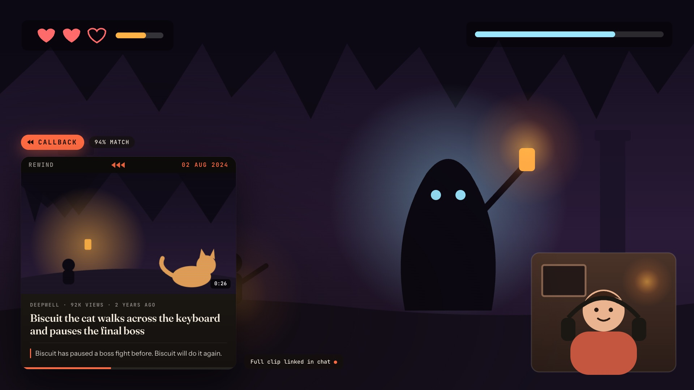
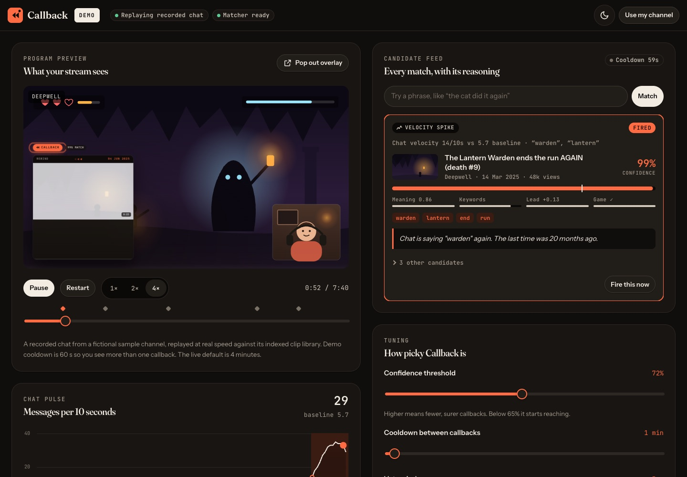
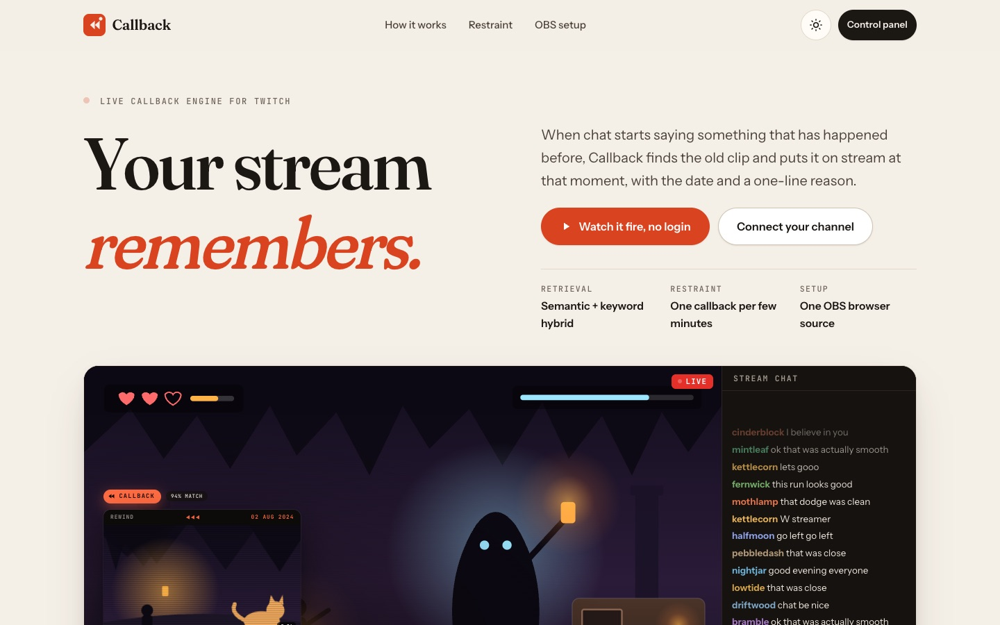

# Callback

**Live demo: [callback.sja-affu765.workers.dev](https://callback.sja-affu765.workers.dev)**

A live callback engine for Twitch streamers. Callback watches live chat and, when what is happening now rhymes with something from the channel's past, brings the old clip back on stream at that moment.



## The problem

The best moments on a stream are callbacks: "you died here last time too", "chat said this in 2023", "you've made this exact joke before". Streams and their communities run on shared history, but that history is locked inside thousands of clips nobody can recall mid-stream.

Highlight tools and clippers look backwards after the stream. Callback looks backwards in real time: it retrieves from the streamer's own clip library as a live production element, so the old moment lands while chat still cares.

## Try it in one minute

Open **[the demo](https://callback.sja-affu765.workers.dev/panel?demo=1)**. No account, no setup, nothing to press.

A recorded chat log replays at real speed against an indexed clip library. Within about 40 seconds chat starts spamming about a boss, the engine spots the spike, finds the clip from 20 months ago, gives you a three second veto window, and the overlay rewinds to it. Over the 7½ minute loop it fires six callbacks and deliberately holds back on near misses, with the reasoning for every decision in the candidate feed.

Want the overlay on its own, for example in OBS? Add `https://callback.sja-affu765.workers.dev/overlay?demo=1` as a browser source and it runs the whole engine by itself.



## What it does

**Control panel** (`/panel`)
- Connect a Twitch account (OAuth, tokens stay server side)
- Index the channel's clip library through Helix with a live progress view
- A program preview that runs the real overlay over a sample scene
- Chat pulse: messages per 10 seconds against a learned baseline, with spikes and triggers marked
- The phrases currently being repeated by several different chatters
- A candidate feed for every match: trigger, top clip, confidence against the threshold, a score breakdown, matched keywords, runner-ups and the decision
- A veto window before any callback reaches the stream (Esc vetoes), plus manual "fire this now" on any candidate
- A "try a phrase" probe to test retrieval by hand
- Tuning: confidence threshold, cooldown, veto window, which triggers are on, and chat posting
- History of what has been played

**Overlay** (`/overlay`) is a transparent 1920 × 1080 page for an OBS browser source. It stays invisible until a callback, then plays the rewind sequence: a scanline sweep, an on-air tally with the match confidence, a date counter that rewinds to the clip's day, the card tilting in, a tape-tracking glitch, the Twitch clip embed (or still) with its title, game, views and age, the one-line reason, a progress bar, and the exit.

**Chat bot** posts the callback in chat with the clip link (through the Helix Send Chat Message endpoint, as the broadcaster).

## How it works

1. **Index.** Helix `/clips` is walked back in six-month windows, so years of history are covered rather than only the all-time top results. Game names are resolved through `/games`. Each clip's title, game and any context is embedded with `@cf/baai/bge-base-en-v1.5` on Workers AI and stored in the channel's Durable Object (SQLite). Search is brute-force cosine in memory, which is fast enough for thousands of clips and needs no managed vector database.
2. **Listen.** The control panel joins the channel's chat over Twitch IRC WebSocket with an anonymous read-only login, so no credentials are needed in the browser. Raids and subs come through IRC `USERNOTICE`. Category changes come from polling Helix `/channels` every minute.
3. **Trigger.** A rolling 60 second window feeds three triggers:
   - a **velocity spike**: messages in the last 10 s at more than 2.2× a slowly learned baseline
   - a **recurring phrase**: 1 to 3 word n-grams said by at least 3 different chatters in 20 s, discounted if the channel says them all the time
   - a **channel event**: a raid, or a change of category
4. **Retrieve.** The window is turned into a query (the recurring phrases, the relevant messages, the current game), embedded, and scored with hybrid retrieval:
   - **meaning**: cosine similarity, calibrated for bge
   - **keywords**: IDF-weighted overlap with the clip title, with recurring phrases weighted up
   - **lead**: how far the best clip is ahead of the next best. Real callbacks stand clearly apart from the pack, while vague chat scores everything about the same.
   - **game**: a small bonus when the clip is from the game being played now
5. **Decide.** A clip fires only if it clears the confidence threshold (72% by default), the cooldown has passed (4 minutes by default), it hasn't been played in the last 30 minutes, and nobody vetoes it in the arming window. Everything else is shown in the feed as held, with the reason.
6. **Play.** The Durable Object broadcasts to every connected overlay over hibernatable WebSockets, writes the history and posts in chat. The reason line is written by `@cf/meta/llama-3.1-8b-instruct-fast` with a 2.5 s budget. It is sanitised, and falls back to a template if the model is slow or the line looks wrong.

## Guardrails

- The live product only searches clips the connected streamer indexed from their own channel. There is no scraping of other channels.
- The Helix client honours `Ratelimit-Remaining` and `Ratelimit-Reset`, backs off before the bucket empties, retries 429s after the reset, and refreshes expired user tokens.
- Low-confidence matches never fire. The threshold, the lead signal, the cooldown, the no-repeat rule and the veto window all stand between a guess and the stream.
- Twitch credentials never reach client code. OAuth state is HMAC-signed, the session is an HttpOnly signed cookie, and overlay links carry a random per-channel key.

## The demo channel

The demo uses a **fictional sample channel** made for this project: the streamer "Juno", the cat Biscuit, every chatter name, and the games (Deepwell, Sky Couriers, Kart Panic, Hollow Harbor). Clip thumbnails and the stream scene are self-made SVG illustrations. No real streamer, game or brand is depicted.

`scripts/build-sample.mjs` generates the library, thumbnails and the replayable chat log deterministically. To use a real public channel's clips instead, register a Twitch application and run:

```sh
TWITCH_CLIENT_ID=… TWITCH_CLIENT_SECRET=… node scripts/fetch-demo-clips.mjs <login>
```

The chat log is written to rhyme with the library, so re-author its scenes in `scripts/build-sample.mjs` to match the new clips, and credit that streamer here.

## Run it locally

Requires Node 20+ and a Cloudflare account (Workers AI runs remotely even in local dev).

```sh
git clone https://github.com/sja-thedude/Callback.git
cd Callback
npm install
npx wrangler login
npm run dev            # http://localhost:8787, and /panel?demo=1 works straight away
```

Set `account_id` in `wrangler.jsonc` to your own Cloudflare account ID (`npx wrangler whoami` lists it).

To connect real Twitch accounts, create an application at [dev.twitch.tv/console](https://dev.twitch.tv/console) with the OAuth redirect URL `http://localhost:8787/auth/callback` (and your deployed origin plus `/auth/callback`). Then copy `.env.example` to `.dev.vars` and fill it in.

### Environment variables

| Name | What it is |
| --- | --- |
| `TWITCH_CLIENT_ID` | Twitch application client ID |
| `TWITCH_CLIENT_SECRET` | Twitch application client secret |
| `SESSION_SECRET` | Long random string used to sign sessions and OAuth state |

In production, set each one with `npx wrangler secret put <NAME>`. Without the Twitch pair, the deployment still serves the full demo and shows a plain explanation on the connect screen.

### Deploy

```sh
npm run deploy
```

### Useful scripts

| Command | What it does |
| --- | --- |
| `npm run sample` | Regenerates the sample library, thumbnails and chat log |
| `npm run demo:fetch` | Fetches a real channel's clips into the demo library (see above) |
| `npm run typecheck` | Type-checks the Worker |

### Regenerating the share image

`public/og.png` is rendered from `scripts/og.html` at 1200 × 630 in a browser.

## Stack

- **Cloudflare Workers** with static assets for the API and pages
- **Durable Objects** (SQLite) per channel: tokens, clip index and vectors, settings, indexing jobs driven by alarms, and overlay WebSockets
- **Workers AI**: `bge-base-en-v1.5` embeddings and `llama-3.1-8b-instruct-fast` for reason lines
- **Twitch**: Helix (clips, games, users, channels, send chat message), OAuth authorization code flow, and IRC over WebSocket for chat
- **Front end**: plain HTML, CSS and ES modules with no build step. Fraunces, Instrument Sans and JetBrains Mono from Google Fonts. Light and dark themes with a toggle. Motion uses transform and opacity only and respects `prefers-reduced-motion`.

```
src/        worker.ts (routes), channel.ts (Durable Object), retrieval.ts (embeddings, hybrid ranking, reasons), twitch.ts (Helix + OAuth)
public/js/  engine.js (triggers + decisions), replay.js (demo clock), irc.js, panel.js, overlay.js, site.js, ui.js
scripts/    build-sample.mjs, fetch-demo-clips.mjs, og.html
```

## Screenshots



## Licence

[MIT](LICENSE)
